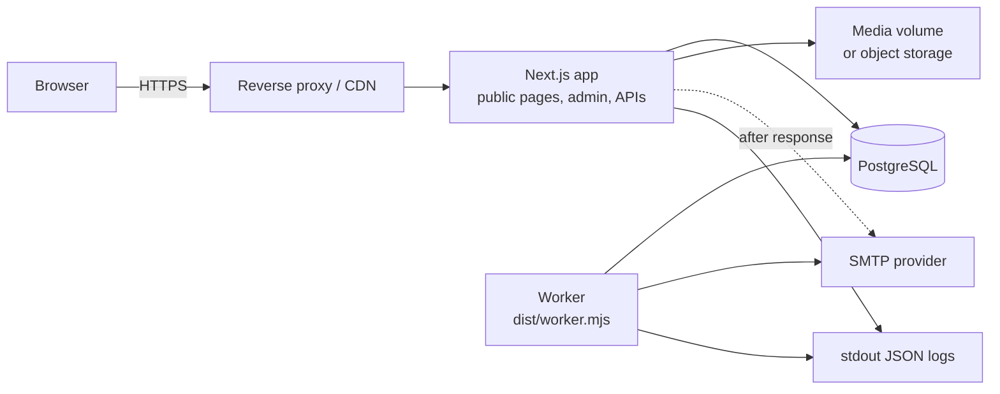

# Architecture

Audience: engineers, architects and security reviewers.

## Components

| Component                | Responsibility                                                                                     | Trust boundary                                                     |
| ------------------------ | -------------------------------------------------------------------------------------------------- | ------------------------------------------------------------------ |
| Browser                  | Renders pages, client-side validation for usability                                                | Untrusted. Every input and permission is re-checked on the server. |
| Next.js app              | Server-rendered public pages, admin UI, server actions, JSON APIs, session enforcement             | Holds secrets; only component exposed to the internet (via proxy). |
| Domain layer (`src/lib`) | Publication rules, enquiry workflow, permissions, retention, audit                                 | Business rules cannot be bypassed by UI controls.                  |
| PostgreSQL               | System of record for content, enquiries, sessions, audit, rate-limit counters, notification outbox | Private network only.                                              |
| Worker                   | Delivers queued email with retries, raises alerts, runs retention and cleanup                      | Same trust level as the app; no inbound traffic.                   |
| Email provider           | Delivers acknowledgements, notifications and alerts                                                | Outbound only; failures never roll back an enquiry.                |

## Key design decisions

**Server rendering with a tag-invalidated data cache.** Public routes are rendered per request from cached
database reads (`unstable_cache`, one hour safety TTL). Publishing invalidates the relevant cache tags, so changes
appear immediately and builds never need database access. Public pages contain no per-visitor data and can be
cached at a CDN if required.

**Draft and published copies.** Each page, service and project keeps an editable working copy and an immutable
published snapshot. Public queries read only snapshots (`publishedSlug IS NOT NULL`), so drafts, edits in progress and
archived items can never leak (BR-01). Editing live content creates a draft revision; the live version stays
unchanged until a publisher publishes again. A failed publish leaves the previous snapshot in place.

**Evidence gate for case studies.** A project that names a client or contains results, a testimonial or images
cannot be published until (a) client permission is recorded as Granted when the client is named and (b) a publisher
records an evidence approval. Any later change to that evidence clears the approval automatically. A database check
constraint also blocks publication while permission is Pending (BR-07, FR-PORT-004).

**Redirects on slug changes.** Publishing with a changed slug creates a permanent (308) redirect from the previous
URL. Redirect chains are flattened, loops are rejected, and live content always wins over a redirect from the same
path. Unknown paths are checked against the redirect table before returning 404 (UC-10).

**Transactional outbox for email.** The enquiry, its service interests, consent record, first activity, audit event
and notification rows are written in one transaction. Success is shown only after commit (BR-04). Delivery happens
after the response and in the worker, with row-level locking (`FOR UPDATE SKIP LOCKED`) so concurrent workers never
send twice. Transient failures retry with backoff (1 min to 6 h, six attempts); permanent failures and exhausted
retries are dead-lettered, logged and alerted to `OPS_ALERT_EMAIL`, and can be retried from the admin area (UC-09).
Internal notifications contain only the reference, service names and a sign-in link.

**Idempotent submissions.** The contact form carries a signed token (HMAC) whose nonce is the idempotency key and
whose timestamp enforces a minimum completion time. The JSON API requires an `Idempotency-Key` header. A unique
constraint makes duplicate creation impossible even under concurrent retries (FR-ENQ-005).

**Rate limiting in PostgreSQL.** Fixed-window counters with an atomic upsert work across any number of stateless
app instances without extra infrastructure. IP addresses are stored only as keyed hashes.

**Authentication.** No identity provider had been selected (DEC-07), so the application includes a contained,
reviewed implementation: scrypt password hashes (N=2^16), opaque random session tokens stored as SHA-256 hashes,
`__Host-` prefixed HttpOnly SameSite=Lax cookies, idle (30 min) and absolute (12 h) expiry, revocation on logout,
password change, deactivation and MFA reset, RFC 6238 TOTP with replay protection and secrets encrypted with
AES-256-GCM, per-IP and per-account rate limits, and temporary lockout. Server actions are protected by Next.js
origin checks; cookie-authenticated route handlers additionally require a same-origin `Origin`. Replacing this with
an OIDC provider later only affects `src/lib/auth`.

**Authorisation.** Six roles map to fifteen permissions ([src/lib/auth/permissions.ts](../src/lib/auth/permissions.ts)).
Every page, server action and API handler checks permissions on the server; domain functions check again. Users cannot
change their own roles, and the last active administrator cannot be removed or deactivated.

**Media.** Uploads are identified by magic bytes, decoded and re-encoded to WebP with sharp (dimension cap,
decompression-bomb guard), which strips EXIF/GPS metadata and neutralises embedded payloads. SVG is not accepted.
Files are stored outside the web root and served by a route that makes an image public only when live content uses
it; otherwise an editor session is required.

**Content safety.** All CMS content is plain text rendered by React (escaped). No user-supplied HTML or Markdown is
ever interpreted. JSON-LD output escapes `<`.

**Observability.** JSON logs with request IDs (set by middleware and returned as `X-Request-Id`) and automatic
redaction of personal fields. `/api/health` (liveness) and `/api/health?ready=1` (database readiness).

## Security headers

Content-Security-Policy (`default-src 'self'`, `frame-ancestors 'none'`, `object-src 'none'`, `form-action 'self'`;
`script-src` includes `'unsafe-inline'` because Next.js bootstraps with inline scripts and nonce-based CSP would
disable caching of every page; residual risk is low because no user-supplied markup is rendered), HSTS in production,
`X-Content-Type-Options: nosniff`, `X-Frame-Options: DENY`, `Referrer-Policy: strict-origin-when-cross-origin`,
`Permissions-Policy`, `Cross-Origin-Opener-Policy`. Admin and API routes add `X-Robots-Tag: noindex` and admin pages
`Cache-Control: no-store`.

## Data model

See [prisma/schema.prisma](../prisma/schema.prisma). Main entities follow spec section 9.2: AdminUser, UserRole,
Session, UserSetupToken, Page, Service, Project, ProjectService, MediaAsset, Redirect, SiteSetting, Enquiry,
EnquiryServiceInterest, EnquiryActivity, ConsentRecord, Notification, AuditEvent, RateLimitBucket. Timestamps are UTC.
Public references use UUIDs and random, non-sequential enquiry references (BR-16). Critical rules are also enforced
by database check constraints (slug format, published-snapshot integrity, client permission, redirect sanity, length
limits, allowed media types).

## Deviations from the proposed baseline

| Proposal in the specification   | What was built                              | Reason                                                                                                              |
| ------------------------------- | ------------------------------------------- | ------------------------------------------------------------------------------------------------------------------- |
| Managed OIDC or session library | Built-in sessions and TOTP (see above)      | Identity provider not yet chosen (DEC-07); contained in `src/lib/auth` for later replacement.                       |
| S3-compatible object storage    | Local filesystem behind a storage interface | Works on a single host with a persistent volume. Horizontal scaling needs an S3 driver implementing `MediaStorage`. |
| Optional NestJS service         | Not used                                    | The spec recommends adding it only when justified.                                                                  |
| Optional Redis                  | Not used                                    | PostgreSQL handles rate limits and job claiming at the expected scale.                                              |
| Attachments (FR-ENQ-010, Could) | Not implemented                             | Disabled by default per DEC-04 until file-handling controls are approved.                                           |
| Scheduled publishing (optional) | Not implemented                             | Marked optional in FR-ADM-006.                                                                                      |
